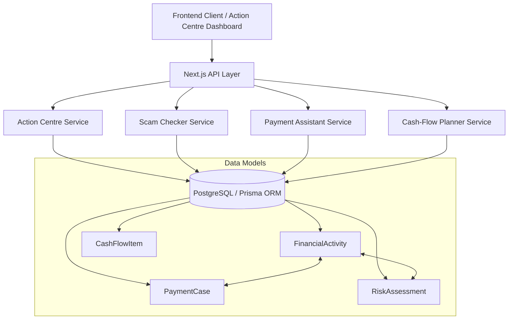

# System Architecture

## Current Architecture
**Status:** **Implemented & Verified** (Phases 1 through 6).
The backend architecture is built as a Next.js App Router modular monolith in TypeScript, utilizing Prisma ORM and Vitest.

### Main Components
1. **Frontend (UI Layer):** Next.js App Router (React, TypeScript) for user dashboards, forecasts, and action centres.
2. **Backend (API Layer):** Next.js Route Handlers providing HTTP APIs with strict Zod request schema validation and privacy-safe logging.
3. **Business Logic & Domain Engines:**
   - **Scam Checker Service:** Rule-based explainable text analyzer (`scamChecker.ts`).
   - **Payment Assistant Service:** State-machine follow-up tracker and official dispute guidance engine (`paymentAssistant.ts`, `paymentGuidance.ts`).
   - **Cash-Flow Calculator Service:** Pure minor-unit (paise) calculation engine with unconfirmed receipt exclusion and conditional scenarios (`cashFlowCalculator.ts`).
   - **Action Centre Service:** Unified aggregator calculating prioritized actions across modules (`actionCentre.ts`).
4. **Data Layer:** Supabase PostgreSQL database managed via Supabase CLI migrations (`supabase/migrations/`) and mapped through Prisma ORM, enforcing PostgreSQL Row Level Security (RLS) on all user-owned records.

### Shared Financial Activity Record & Action Centre
A central persistence model connecting all modules:
- Delayed/problematic payments recorded in the Payment Assistant create linked `FinancialActivity` records (`UNCONFIRMED`).
- Cash-Flow Planner reads confirmed records for available funds while isolating unconfirmed receipts in conditional what-if scenarios.
- The Action Centre dynamically joins active payment follow-ups, cash-flow shortfalls, unconfirmed receipts, and scam alerts.
- State transitions (confirming receipt or resolving case) cascade atomically using database transactions (`$transaction`).

### Architecture Diagram

### Authentication and Authorization
Enforces user isolation across all endpoints via `x-user-id` session header with strict 401 Unauthorized and 403 Forbidden checks.

### Regulatory Disclaimers
YUKTHI does not claim direct banking integrations or automated reversal capabilities. Statuses are user-reported and projections are non-guaranteed estimates.

